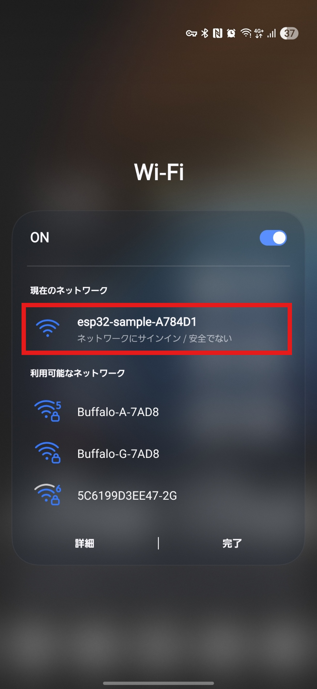
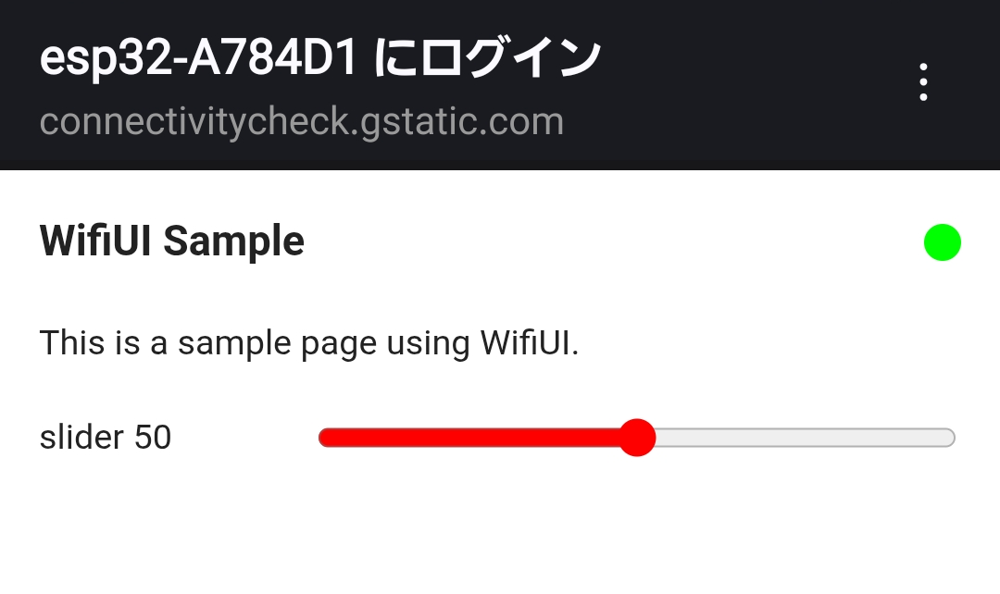
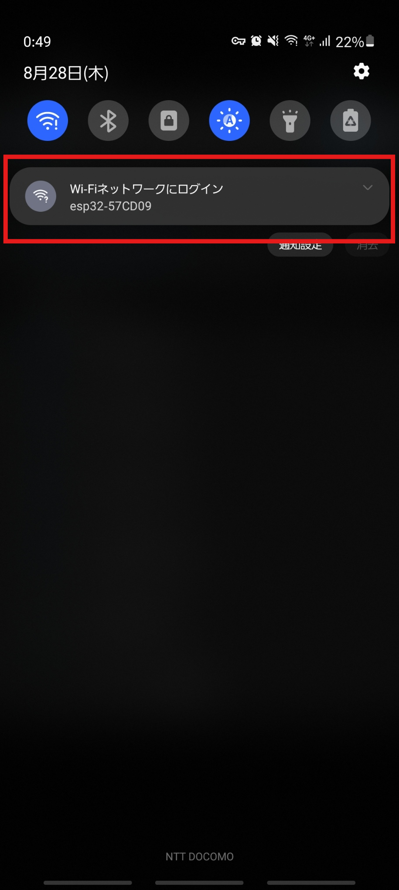
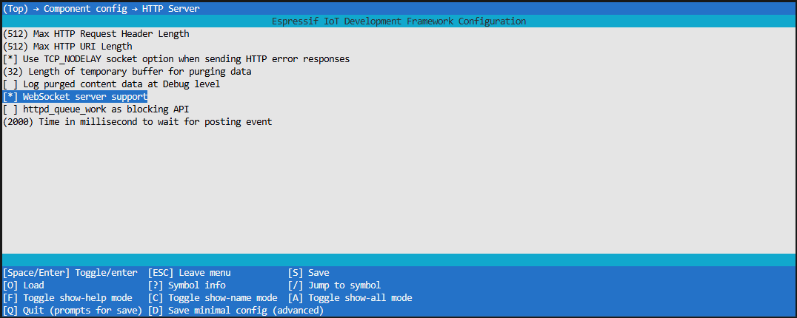
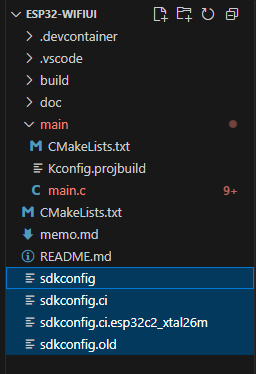

# WifiUIとは？

**Wifi経由で開けるESP32のGUI作成ライブラリ**  
ESP32のアクセスポイントにスマホやPCを接続することでブラウザ経由開けるUIを提供  
つまりワイヤレスでESP32の操作やデバッグなどが可能になる

サポート機能
- 動的テキスト
- ボタン
- スライダー
- 2D、3Dグラフ
- 外部Wifi接続フォーム
- 標準入出力コンソール

など


---
# Getting Started

## 動作環境

- ESP-IDF v6.0.0
- ESP32-S3で動作確認済み

## サンプル実行手順

1. 本プロジェクトをビルドしESP32にFlash
    1. `idf.py menuconfig` でWebSocketを有効化する > 詳細：[ESP-IDFでWebSocket有効化](#ESP32での実装方法)
    1. build & Flash（`idf.py build flash`）
1. ESP32を起動
1. PCやスマホで **SSID: esp32-XXXXXX**（XXXXXXはESP32のMACアドレス下6桁）に接続  
    
1. **「ネットワークにサインイン」** を選択  
    （iOSやWindowsはこの操作は不要かもしれない）  
    
    
1. UIページが立ち上がる  
    

---
# デベロッパーマニュアル
## 開発環境
- VS Code
    - ESP-IDF V5.4.1 Extension (詳細はRADECHのドキュメント、もしくは[ESP32S3_helloworld](https://github.com/lelt0/ESP32S3_helloworld)を参照)    
    - 使用モジュール：
        - [HTTP Server](https://docs.espressif.com/projects/esp-idf/en/stable/esp32/api-reference/protocols/esp_http_server.html)
        - [Wi-Fi](https://docs.espressif.com/projects/esp-idf/en/stable/esp32/api-reference/network/esp_wifi.html)  
    - （できるだけライブラリサイズを小さくしたかったので、ArduinoライブラリではなくEPS-IDFベースで作成した）
- ESP32
    無印もしくはS3で動作確認

## UIの作成方法

T.B.D


---
# トラブルシューティング
## ESP-IDF ビルドエラー
- トラブル：以下のように不可解なビルドエラーになる
    ```
    C:/Users/delle/esp/v5.4.1/esp-idf/components/esp_lcd/rgb/esp_lcd_panel_rgb.c: In function 'rgb_panel_draw_bitmap': 
    C:/Users/delle/esp/v5.4.1/esp-idf/components/esp_lcd/rgb/esp_lcd_panel_rgb.c:681:1: internal compiler error: Segmentation fault
     681 | } | ^ 
     Please submit a full bug report, with preprocessed source (by using -freport-bug). 
     See <https://gcc.gnu.org/bugs/> for instructions.
    ```
- 解決方法：
1. buildフォルダを手動で削除
1. `idf.py fullclean`
1. `idf.py build`

---
# 内部仕様（開発メモ）

## 全体シーケンス
T.B.D

## キャプティブポータル
特に公衆Wi-Fiなどのネットワークに接続したときに、インターネットアクセスの前にユーザーにログインや同意を求めるWebページを表示する仕組み。  
WifiUIではこのキャブティブポータルで自動でOSのミニブラウザが特定のURIにアクセスする仕組みを利用し、  
ユーザがIPアドレスを直接ブラウザに打ち込まなくてもESP32のUIにアクセスできる仕組みを作った

### 実装のポイント
Captive PortalはOSが自動的にインターネットへのアクセスを試行し、インターネット接続できなければリダイレクトされたページを(ミニ)ブラウザで表示する。  
つまり、基本的には
- ESP32内のDNSサーバで任意のドメインをESP32のアクセスポイントIPとして解決させること
- ESP32内のHTTPサーバで予期しないURIへのアクセスをすべて用意したポータルサイト（index.htmlなど）にリダイレクトすること  

ができればCaptive Portalを実現できる。

ただし、このインターネットアクセス試行先URLや「インターネットに繋がった」とみなす判定方法がOS（もしくはベンダー）ごとに異なるのがクセモノ。  
以下に自分のほうで調べたものも含め、各OSの挙動を示す。

- **Google Android, ChromeOSの場合（主にGoogle製のもの）：**  
`http://connectivitycheck.gstatic.com/generate_204`にアクセス可能かでインターネット接続を判定する。  
もしインターネット接続できている場合はこのページが`204 No Content`を返すので、その場合はキャプティブポータル無しと判断する。
    - **Samsungスマートフォン：**  
    これがクセが強く、リダイレクトするIPアドレスが192.168.xxx.xxxなどのprivate IPだとCaptive Portalと認識してくれず、「接続が不安定」などと表示されブラウザが自動で起動しない。  
    対策としてはpublicなIPアドレスを指定する必要がある。
        - しかし愚直にpublicなIPアドレスを指定すると、複数のNICを持つデバイスで1つのネットワークインターフェース（NI）でインターネットに、もうひとつのNIでESP32に接続した場合、publicなIPアドレスをネットにつながった方のNIで解決しようとするのでESP32のUIページに誘導できない問題がある。  
        （そもそもCaptivePortalはインターネットアクセスを承認するための仕組みなので、インターネットに接続できているならPortalページを開く必要がないのは正しい挙動なのだが…）
        なのでこのケースではクライアント端末側で対応するしかないかも。例えばWindowsであれば自動メトリックをOFFにして、Wifiを有線LANより優先させるとか…
- **Apple macOS, iOS/iPadOSの場合（Apple製のもの）**  
`http://captive.apple.com/hotspot-detect.html`にアクセスして、  
`<HTML><HEAD><TITLE>Success</TITLE></HEAD><BODY>Success</BODY></HTML>`  
が返ってきたらキャプティブポータル無しと判断する。  
それ以外のコンテンツが返ってきたら、ブラウザを自動起動してそれを表示する
- **Microsoft Windowsの場合**  
    - **Windows10,11**  
    `http://www.msftconnecttest.com/connecttest.txt`にアクセスして、文字列`Microsoft Connect Test`が返った場合は、キャプティブポータル無しと判断する。  
    異なるコンテンツが返ってきたら、`http://www.msftconnecttest.com/redirect`にアクセスしてそのコンテンツを表示する。  
        - なお、WindowsにはNetwork Connectivity Status Indicator (NCSI) という仕組みがあり、これが20～30秒間隔で`connecttest.txt`にアクセスしてくるので、ポータルページを開いているときは定期的にアクセスログが出てくる
        - また、プロキシサーバー自動検出のため、WindowsのWPAD機能が有効になっている場合は`http://wpad/wpad.dat`へ頻繁にアクセスしてくる。このアクセスがあまりにも多いとESP32がパニックになるので、`/wpad.dat`へのアクセスには**404**を返すといい
    - **Windows8.1以前**  
    上記`http://www.msftconnecttest.com/connecttest.txt`の代わりに`http://www.msftncsi.com/ncsi.txt`を用いる[らしい](https://learn.microsoft.com/ja-jp/troubleshoot/windows-client/networking/internet-explorer-edge-open-connect-corporate-public-network)  
- **FireFox**  
Firefoxの独自実装として、`http://detectportal.firefox.com/success.txt`にアクセスしてステータス200で文字列`success`が返ればポータルなしと判断する。

上記のように各OSごとにCaptivePortalの挙動が異なるのはやはり問題視されているようで、
2020年に[RFC 8908](https://datatracker.ietf.org/doc/html/rfc8908)などで標準化された。  
しかし、2025年8月現在まだあまり普及していないらしく、今回のコードでも実装していない。

### 参考ページ
- [espressif ESP-IDF公式のcaptive portalサンプル](https://github.com/espressif/esp-idf/tree/master/examples/protocols/http_server/captive_portal) ただし基本的なCaptivePortalのみの実装で、すべてのOSのCaptivePortalに対応しているわけではない
- [有志によるCaptivePortalの実装](https://github.com/CDFER/Captive-Portal-ESP32) ただしArduinoライブラリを使っており約700kBも使ってしまうので

## Ploty.js
自作のグラフ描画スクリプト. 簡単な2Dプロットおよび3Dプロットを描画可能  
使用方法は /ploty/src/ploty.js などを参照  
  
### ビルド方法（minify & gzip）
1. `cd ploty`
1. `npm run build`
1. components/wifi_ui/assets/ploty.min.js.gz ができる
1. ESPではバイナリファイルを以下のようにROM領域に埋め込むことができる (cf.[ESP-IDF Programming Guide](https://docs.espressif.com/projects/esp-idf/en/stable/esp32/api-guides/build-system.html#embedding-binary-data))
    ```CMake
    # components\wifi_ui\CMakeLists.txt
    target_add_binary_data(${COMPONENT_LIB} "./assets/ploty.min.js.gz" BINARY)
    ```
    ```c
    extern const uint8_t ploty_min_js_gz_start[] asm("_binary_ploty_min_js_gz_start");
    extern const uint8_t ploty_min_js_gz_end[]   asm("_binary_ploty_min_js_gz_end");
    const size_t len = ploty_min_js_gz_end - ploty_min_js_gz_start;
    ```

## WebSocket通信
ウェブブラウザなどのクライアントとサーバーの間で、リアルタイムかつ双方向の通信を可能にする通信プロトコル.  
一度接続が確立されると、その接続が維持され、その間はサーバ・クライアントともに任意のタイミングでデータ送信が可能。  
いつ接続が切断されるかはOS依存っぽい（例えばスマホ機種によって、アプリを明確に終了しなければ切れなかったり、「戻る」操作だけで切れたり）  

ちなみにESP-IDFには[WebSocket Client](https://docs.espressif.com/projects/esp-idf/en/v4.2/esp32/api-reference/protocols/esp_websocket_client.html)のコンポーネントもあったが、あまり余計なライブラリに依存したくなかたのですべて[HTTP_Server](https://docs.espressif.com/projects/esp-idf/en/stable/esp32/api-reference/protocols/esp_http_server.html)だけで実現した。

### ESP32での実装方法
1. `idf.py menuconfig`でWebSocketを有効化する
    1. `idf.py menuconfig`
    1. `[*] Enable WebSocket support`  
        
    1. `sdkconfig`が更新される  
        
1. C実装
    - **（ESP32にとっての）受信**  
        WebSocket URIに対するイベントハンドラで処理すればOK  
        - NOTE: `httpd_ws_recv_frame()`1回で取得しようとしたがなぜか取得できず（バッファが更新されず）、  
        以下のように`httpd_ws_recv_frame()`を2回呼ぶことで取得できるようになった（length取得→payload取得）。
        ```C
        static esp_err_t ws_status_handler(httpd_req_t *req) {

            // ...

            // Websocket message receiving

            httpd_ws_frame_t ws_pkt;
            memset(&ws_pkt, 0, sizeof(httpd_ws_frame_t));
            ws_pkt.type = HTTPD_WS_TYPE_TEXT;
            esp_err_t ret = httpd_ws_recv_frame(req, &ws_pkt, 0); // to get frame length
            if (ret != ESP_OK) {
                // httpd_ws_recv_frame failed to get frame len
                return ret;
            }
            if (ws_pkt.len)
            {
                uint8_t *buf = (uint8_t*)calloc(1, ws_pkt.len + 1);
                ws_pkt.payload = buf;
                ret = httpd_ws_recv_frame(req, &ws_pkt, ws_pkt.len); // to receive frame payload
                if (ret != ESP_OK) {
                    // httpd_ws_recv_frame failed
                    free(buf);
                    return ret;
                }
                free(buf);
            }
            return ESP_OK;
        }
        ```
    - **（ESP32にとっての）送信**  
        ESP-IDFのAPI的にWebSocketで接続したクライアントを覚えておいてくれないみたいなので、  
        クライアントのファイルディスクリプタを覚えておく機能を自前で実装した。  

        ESP32からデータを送信する際は、そのファイルディスクリプタ経由で送信する。  

        なお、ESP32への負荷軽減のため、以下の制約がある
        - 1つのクライアントと接続できるWebSocketは1つのみ  
            ← 死んでいるページにWebSocketで送信しまくっても意味がなく、負荷になるだけなので
        - 接続できるクライアントは2台まで  

        以下具体的な実装
        1. クライアント登録  
            クライアントからWebSocket接続要求がありコネクションが確立されるときはクライアントからGETリクエストが送信される。  
            そのときに、クライアントの**IPアドレス**と**ファイルディスクリプタ**のセットを覚えておく  

            もしすでに接続済みのクライアントだった場合、新しいファイルディスクリプタで上書きする
        1. データ送信  
            1.で記憶したファイルディスクリプタに向けて`httpd_ws_send_frame_async()`で送信する  
            - NOTE: WebSocket送信関数として、
                - httpd_ws_send_frame()
                - httpd_ws_send_frame_async() *
                - httpd_ws_send_data() *  
                - httpd_ws_send_data_async()

                が用意されているが、なぜか動作したのは「*」がついた2つだけだった。なぜ？  
        1. クライアント切断  
            データ送信時に送信失敗した場合、切断されたとみなし**IPアドレス**と**ファイルディスクリプタ**のセットを削除する  
        
    - **バイナリデータの送受信**  
    3Dプロットのデータ送信は、点数が多いのでバイナリデータで送受信している。  
    WebSocket通信が確立すると、サーバ側で定期送信用タスクを立ち上げて送信。WebSocket通信が切れるとタスクも終了。  
    詳細はソースコード参照。  

## ESP-IDFプロジェクトのフォルダ構成
ESP-IDFのお作法に従い、以下のような構成になっている。  

project_dir  
├ CMakeLists.txt  
├ main  
│├ CMakeLists.txt  
│└ main.c  
├ components  
│└wifi_ui  # 各自作コンポーネントが並ぶ  
│ ├include  
│ │└ *yyy.h*  
│ ├ CMakeLists.txt  
│ └ *yyy.c*  
├ sdkconfig  
...

### ESP-IDFコンポーネントのリンク方法

mainフォルダ以下とcomponentsフォルダ以下でESP-IDFコンポーネントの解決方法が異なる。  

ESP-IDF には 「自動依存解決 (auto-require)」 という仕組みがあります。
- あるコンポーネントが**公開ヘッダーファイル (include ディレクトリにあるもの) **を利用するとき、そのヘッダを提供しているコンポーネントをビルドシステムが自動的に見つけて依存に追加してくれます。
- しかし、別コンポーネントから呼ぶ場合は例外。そのコンポーネントの CMakeLists.txt に REQUIRES で明示しないといけません。

つまり、mainフォルダ内ではCMakeLists.txtに何も書かなくてもヘッダーを使っていればコンポーネントが自動解決されるが、  
componentsフォルダ以下の独自の wifi_ui コンポーネントでは手動で PRIV_REQUIRES する必要がある。  

NOTE:  
FreeRTOSでC++ソースを混ぜて使う場合は、**extern "C"** void app_main(void)する必要がある。  

## ESP32のログ介入
WifiUIにシリアルログをミラーリングするため、UIページにシリアルログが含まれる場合、標準出力や標準エラー出力を盗んでいる。（`esp_vfs_register_fs` & `freopen`）
