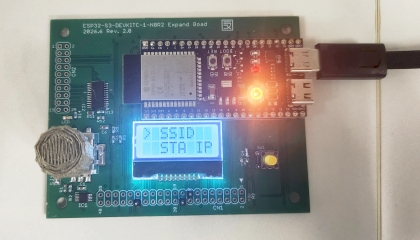

# ESP32-S3 Expand Board WifiUI Sample

This project is a firmware sample for the RADECH ESP32-S3 Expand Board.
It demonstrates synchronized control between the board's hardware controls,
its character LCD and RGB LED, and a browser-based interface provided by
WifiUI.



## Hardware

- RADECH ESP32-S3 Expand Board
  - 2 x 8 character I2C LCD
  - Rotary encoder/volume control
  - Tact switch
  - WS2812 RGB LED

The default hardware connections are:

| Function | GPIO |
| --- | --- |
| Rotary encoder A | 45 |
| Rotary encoder B | 46 |
| Rotary encoder switch | 47 |
| Tact switch | 0 |
| RGB LED | 48 |
| LCD I2C SDA | 8 |
| LCD I2C SCL | 9 |

The LCD module is detected automatically at one of I2C addresses `0x3C`,
`0x3E`, `0x27`, or `0x3F`.

## Features

### WifiUI

At startup, the firmware creates a WifiUI page containing:

- Boot time
- RGB LED ON/OFF switch
- Red, green, and blue sliders
- RGB value time plot
- Mirror serial console
- External Wi-Fi connection form
- Current STA IP address

The ESP32 runs an access point and displays a captive portal, allowing a
phone or PC to open the control page without entering an IP address manually.
Changing a control in the browser updates the board hardware immediately.

### LCD and rotary encoder

The character LCD provides a local menu. Turning the rotary encoder moves the
selection or adjusts the selected value. Pressing the encoder opens or closes
the selected menu item.

The available LCD menu items are:

- Wi-Fi AP SSID
- STA IP address
- LED ON/OFF
- Red LED value
- Green LED value
- Blue LED value

The rotary encoder and tact switch also operate the same application state as
the WifiUI controls:

- Turning the encoder changes RGB values or toggles ON/OFF where applicable.
- Pressing the tact switch toggles the LED ON/OFF state.
- Changes made by a board control are reflected in the corresponding WifiUI
  slider or switch.

### Other controls

The serial input supports the following commands:

- `chip`: show ESP32 chip and flash information
- `ram`: show stack and heap usage
- `server`: show WifiUI server status

## Requirements

- ESP-IDF
- ESP32-S3 target
- VS Code with the Espressif IDF extension is recommended

## Build and run

1. Open this project in an ESP-IDF development environment.
2. Enable WebSocket support if it is not already enabled.
3. Build and flash the firmware:

   ```text
   idf.py build flash monitor
   ```

4. After booting, connect to the ESP32 access point.
5. Open the WifiUI page through the captive portal or the address shown by
   the ESP32.

## Source layout

- `main/main.c`: application, WifiUI page, LCD menu, and hardware-to-UI
  synchronization
- `main/lcd_char2x8.c`: 2 x 8 character LCD I2C driver
- `main/rot_encoder.c`: rotary encoder and encoder-button handling
- `main/switch.c`: tact switch handling
- `main/led_ws2812.h`: WS2812 RGB LED control
- `components/wifi_ui/`: WifiUI server and UI element implementation
